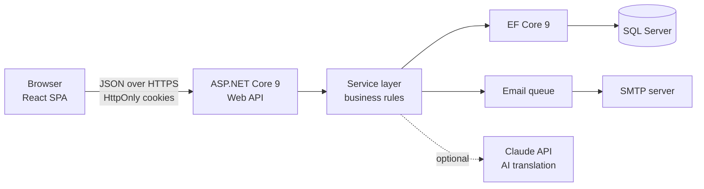
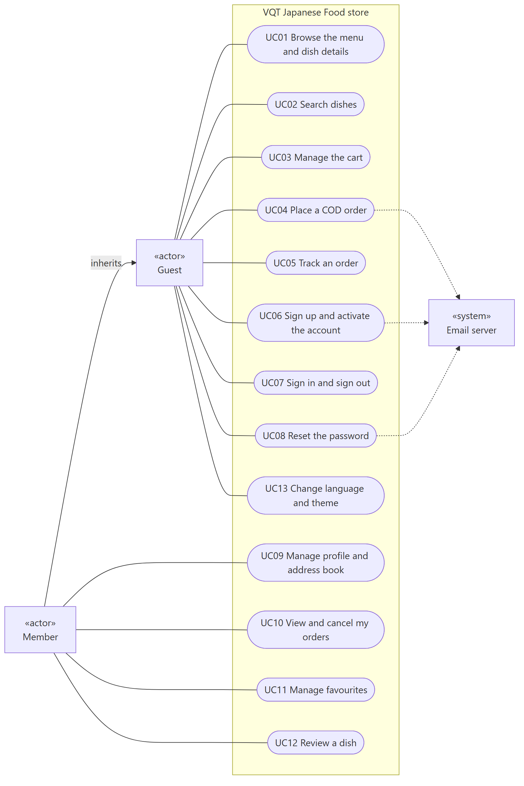
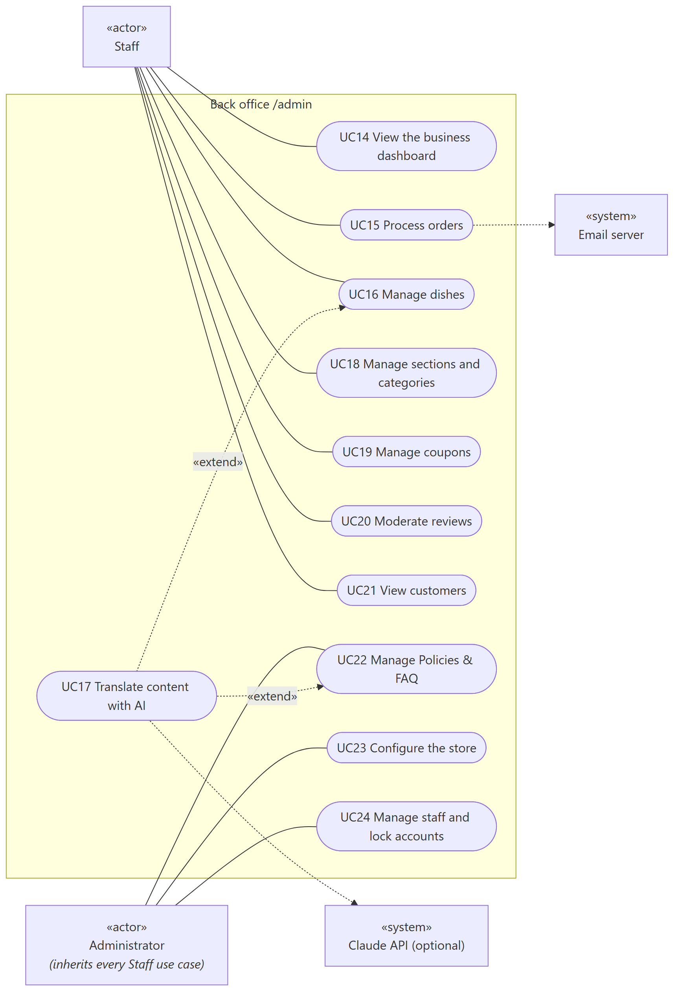
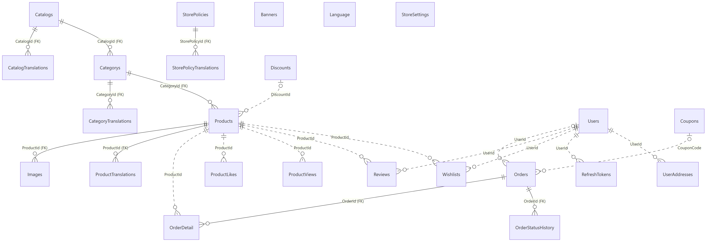
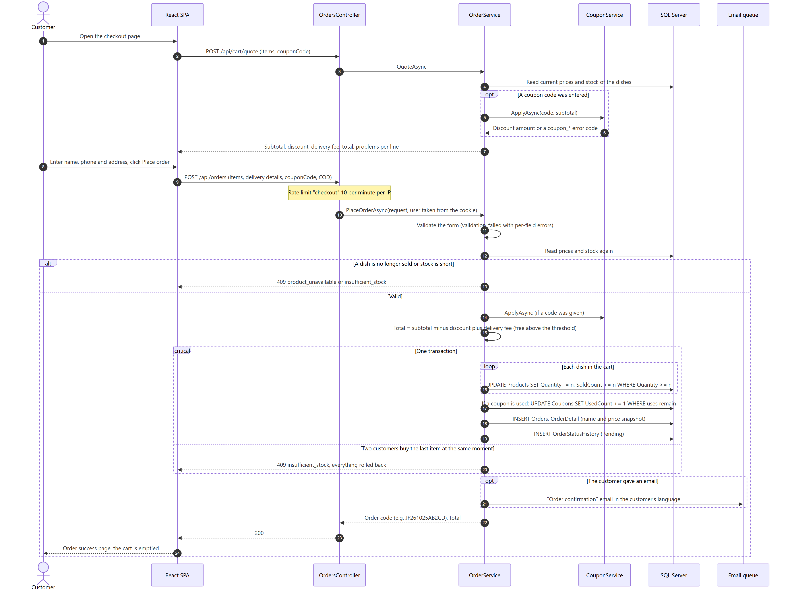

# 🍣 VQT Japanese Food

A full-stack e-commerce web application for a Japanese food store in Vietnam: an online storefront for customers and a back office for the store owner and staff.
It started as a classic ASP.NET MVC website and was rebuilt as a React single-page application on top of an ASP.NET Core Web API.

**Type:** personal full-stack project · **Year:** 2026 · **Market:** Vietnam (prices in VND, cash on delivery)

---

## ✨ Features

**Storefront**
- Menu organised by section and category, dish pages with photos, reviews and "frequently bought together"
- Accent-insensitive search that works in any of the 5 languages (type "sashimi ca hoi" and still find "Sashimi cá hồi")
- Cart, checkout without an account, coupons, free delivery above a threshold, cash on delivery
- Order tracking with the order code and phone number
- Customer accounts: sign up with email activation, address book, order history, favourites, reviews
- 5 languages (Vietnamese, English, Japanese, Korean, French) and 4 colour themes (light, dark, ocean, midnight)

**Back office (`/admin`)**
- Revenue dashboard: today and 30-day revenue, orders, average order value, best sellers, low-stock alerts
- Order workflow (Pending → Confirmed → Preparing → Out for delivery → Delivered) with an email to the customer at every step
- Dish management: photos (drag and drop), translations, SEO fields, bulk actions; optional "Translate with AI"
- Catalog, coupons, review moderation, customers, Policies & FAQ, store settings
- Two roles (Staff, Administrator); locking an account or removing a role takes effect almost immediately

**Emails**
- Order confirmation, status updates, activation and password-reset codes, sent in the customer's language, with a dark-mode layout

---

## 🛠️ Tech stack

| Area | Technology |
|---|---|
| Backend | C#, .NET 9, ASP.NET Core Web API, Entity Framework Core 9 |
| Database | SQL Server (24 tables, managed with EF Core migrations) |
| Frontend | React 19, TypeScript, Vite 8, Tailwind CSS 4, React Router 7, TanStack Query 5, Zustand, React Hook Form + Zod, i18next |
| Security | JWT in HttpOnly cookies, rotating refresh tokens, role-based authorisation, rate limiting, ASP.NET Core password hashing |
| Email | SMTP through a background queue, HTML templates in 5 languages |
| AI (optional) | Claude API via the official Anthropic C# SDK, for drafting translations in the back office |
| Testing | xUnit with in-memory SQLite (84 tests), Vitest (48 tests) |
| Tools | Visual Studio, VS Code, Git & GitHub, Claude Code (AI pair programming) |

---

## ⚙️ How it works



- **Layered backend.** Controllers only handle HTTP (identity, language, rate limits, caching); every business rule lives in the service layer, which is unit-tested without a web server.
- **Server-side pricing.** The browser only sends dish ids and quantities. Prices, coupons, delivery fee and total are recalculated on the server, so a modified request can never change what the customer pays.
- **Safe stock handling.** Placing an order decrements stock with a conditional update inside a database transaction, so two customers can never both buy the last item. Order lines keep a snapshot of the name and price at the time of purchase.
- **Sessions.** Access tokens last 15 minutes and refresh silently; refresh tokens rotate on every use and only their hash is stored. Reusing an old token signs the account out everywhere.
- **Back-office access.** Every admin request re-checks the user's role and lock state, so access can be revoked without waiting for a token to expire.
- **Multilingual content.** Dishes, categories and policies have translation tables; the API answers in the language the browser asks for and falls back to Vietnamese. Search uses a precomputed, accent-free index covering all languages.
- **Fast catalog.** Public catalog responses are cached on the server for 60 seconds and cleared automatically whenever staff change something.
- **Non-blocking email.** Emails are queued and sent in the background, so checkout never waits for the mail server.

### Diagrams

| Use cases (store) | Use cases (back office) |
|---|---|
|  |  |

**Database overview (24 tables)**



**Placing an order (sequence diagram)**



The project's own documentation also includes the full ERD with every column, seven sequence diagrams and detailed use case specifications.

---

## ▶️ Running it locally

**Requirements:** .NET SDK 9+, Node.js 22, SQL Server (Express is enough), `dotnet-ef` (`dotnet tool install --global dotnet-ef`).

```bash
# 1. Secrets live outside the code (user-secrets in development)
cd JapaneseFood.Api
dotnet user-secrets set "ConnectionStrings:VQTConnections" "<SQL Server connection string>"
dotnet user-secrets set "Jwt:Key" "<random string, 32+ characters>"
dotnet user-secrets set "SmtpSettings:Password" "<SMTP app password>"   # optional, for emails
cd ..

# 2. Create the database and load the sample menu (76 dishes in 5 languages)
dotnet ef database update --project JapaneseFood.Entity --startup-project JapaneseFood.Api
dotnet run --project JapaneseFood.Api -- --seed-menu seed

# 3. Build the frontend and start the API (it also serves the React app)
cd frontend && npm ci && npm run build && cd ..
dotnet run --project JapaneseFood.Api --launch-profile http
```

Then open http://localhost:5080 (store) and http://localhost:5080/admin (back office). A default administrator account is created on first run; change its password straight away.

For UI work, run `npm run dev` in `frontend/` as well and open http://localhost:5173: pages reload on save and API calls are proxied to port 5080.

**Tests**

```bash
dotnet test JapaneseFood.Tests/JapaneseFood.Tests.csproj   # 84 backend tests
cd frontend && npm test                                    # 48 frontend tests
```
